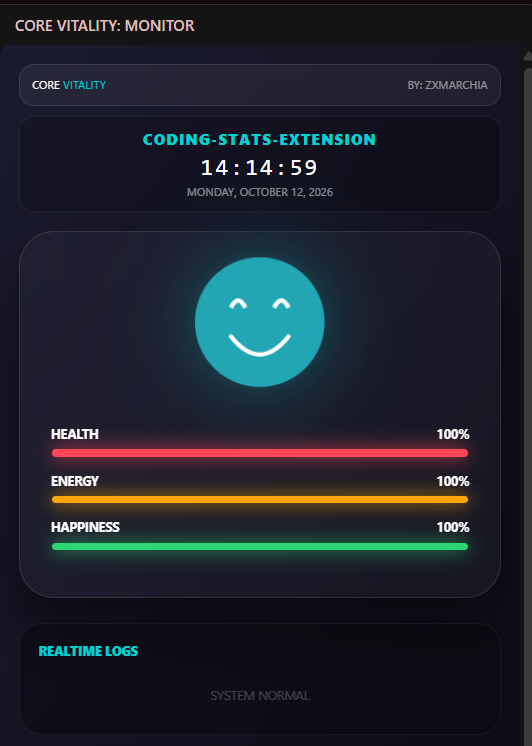
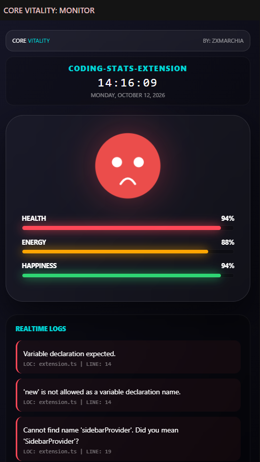

<div align="center">

# 🌌 CORE VITALITY
### *Ultra-Luxury Coding Health Tracker & Realtime Diagnostics Dashboard for VS Code*

[](LICENSE)
[](https://code.visualstudio.com/)
[](package.json)
[](https://github.com/notbell1)

Created with ❤️ by **[NTTBELL](https://github.com/notbell1)**

---

</div>

## 🌟 Tentang CORE VITALITY

**CORE VITALITY** adalah ekstensi Visual Studio Code bertema *ultra-luxury* dan *cyber-space* yang memantau performa dan kesehatan koding Anda secara real-time. Ekstensi ini menghadirkan karakter interaktif animasi SVG yang dapat berevolusi secara dinamis sesuai kualitas kode Anda, dibalut antarmuka modern berestetika **Nebula Glassmorphism**.

Dashboard ini melacak bar **Health**, **Energy**, dan **Happiness** Anda. Ketika kode Anda bersih, karakter berada dalam performa prima. Namun ketika kode Anda memicu error, karakter akan terluka dan menampilkan log insiden lengkap beserta nama file dan nomor barisnya!

---

## 📸 Tampilan Antarmuka (Preview)

Berikut adalah perbandingan tampilan dashboard saat kode bersih tanpa error dan saat terjadi error:

| 🟢 Kondisi Bersih (0 Error) | 🔴 Terdeteksi Error (Incident Logs) |
| :---: | :---: |
|  |  |
| **Karakter Bahagia (God Mode / Stable)**<br>Semua bar stat berada di 100%.<br>Realtime logs menampilkan status `SYSTEM NORMAL`. | **Karakter Terluka & Cemas (Panic Mode)**<br>Health, Energy, & Happiness berkurang.<br>Realtime logs menampilkan pesan error, nama file (`LOC`), & nomor baris (`LINE`). |

---

## ✨ Fitur Utama

- 🎭 **5-Stage Animated SVG Character Evolution**  
  Karakter hidup dengan animasi *breathing* dan *floating* yang mengubah ekspresi wajah, warna tubuh, serta pendar aura berdasarkan status vital dan tingkat error Anda:
  - **God Mode** (HP & Energy $\ge$ 95%): Wajah cyan berseri-seri, aura pendar cerah.
  - **Stable**: Ekspresi senyum tenang dengan aura nebula indigo.
  - **Tired** (Energy $\le$ 40%): Ekspresi lelah dengan aura oranye hangat.
  - **Panic** (> 2 Error atau HP $\le$ 60%): Wajah sedih/panik dengan aura peringatan merah menyala.
  - **Critical** (HP $\le$ 30%): Wajah pucat dengan mata silang `X` dan aura ungu gelap.

- ⚡ **Realtime Event-Driven Diagnostics Engine**  
  Terhubung langsung dengan *VS Code Language Diagnostics*. Setiap error unik yang terdeteksi di file editor aktif akan memberikan *damage* instan:
  - **Health**: $-1\%$
  - **Energy**: $-2\%$
  - **Happiness**: $-1\%$

- 📋 **Realtime Incident Logs (Path & Line Number)**  
  Menampilkan kartu log kesalahan secara langsung pada sidebar:
  - **Pesan Error**: Penjelasan masalah diagnosa kode.
  - **Lokasi File (`LOC`)**: Menampilkan nama file dokumen yang mengalami error (contoh: `extension.ts`).
  - **Nomor Baris (`LINE`)**: Menunjukkan posisi baris tempat error terjadi (contoh: `LINE: 14`).
  - **System Normal**: Muncul saat file bersih tanpa error.

- 🌿 **Automatic Slow Recovery**  
  Ketika semua error berhasil Anda perbaiki (0 error aktif), sistem secara otomatis memicu pemulihan berkala:
  - Health $+0.3\%$
  - Energy $+0.4\%$
  - Happiness $+0.5\%$

- 🌌 **Nebula Glassmorphism Aesthetic**  
  Latar belakang galaksi bergerak halus (*infinite multi-layer gradient animation*) dipadukan dengan kartu efek kaca (*frosted glassmorphism*) dan efek glow bercahaya.

- ⏱️ **Hacker Clock & Dynamic Workspace Indicator**  
  Menampilkan nama workspace/project yang sedang Anda buka serta jam digital dan tanggal presisi sesuai waktu lokal perangkat Anda.

---

## 📊 Matriks Status & Karakter

| Status | Syarat Kondisi | Warna Tubuh | Warna Aura | Ekspresi Wajah |
| :--- | :--- | :--- | :--- | :--- |
| **God Mode** | HP $\ge$ 95% & Energy $\ge$ 95% | Teal `#22a6b3` | Cyan `#00d2d3` | Senyum lebar & mata berbinar |
| **Stable** | Kondisi normal standar | Indigo `#4834d4` | Biru `#686de0` | Senyum lembut |
| **Tired** | Energy $\le$ 40% | Jingga `#f0932b` | Oranye `#ffa502` | Mulut datar, mata mengantuk |
| **Panic** | Error > 2 atau HP $\le$ 60% | Merah `#eb4d4b` | Merah `#ff4757` | Mulut cemberut, mata bulat panik |
| **Critical** | HP $\le$ 30% | Gelap `#2c3e50` | Ungu `#8e44ad` | Mulut datar, mata silang `X` |

---

## 🛠️ Instalasi

### Metode 1: Melalui VS Code Marketplace
1. Buka Visual Studio Code.
2. Tekan `Ctrl + Shift + X` (Windows/Linux) atau `Cmd + Shift + X` (macOS) untuk membuka tab **Extensions**.
3. Ketik **"CORE VITALITY"** pada kolom pencarian.
4. Klik **Install**.

### Metode 2: Instalasi Manual via File VSIX
Jika Anda memiliki berkas package `.vsix`:
```bash
code --install-extension core-vitality-1.0.0.vsix
```
Atau melalui GUI:
1. Buka tab **Extensions** di VS Code.
2. Klik ikon titik tiga (`...`) di pojok kanan atas tab Extensions.
3. Pilih **Install from VSIX...** dan pilih file `core-vitality-1.0.0.vsix`.

---

## 🚀 Cara Menggunakan

1. Setelah terpasang, klik ikon **Detak Jantung / Pulse** (`$(pulse)`) pada **Activity Bar** (bilah navigasi sebelah kiri VS Code).
2. Panel sidebar **CORE VITALITY: MONITOR** akan terbuka.
3. Mulailah membuka project atau mengedit file kode:
   - Nama workspace aktif akan langsung terdeteksi.
   - Jam digital lokal akan berdetik secara real-time.
   - Tulis kode Anda. Jika muncul kesalahan sintaks atau type error, Anda akan melihat status karakter menurun seketika disertai daftar log error.
   - Perbaiki semua error untuk melihat karakter pulih kembali ke kondisi prima (*God Mode*)!

---

## 💻 Pengembangan Lokal (Development)

Untuk Anda yang ingin memodifikasi atau mengembangkan ekstensi ini:

1. **Clone repositori**:
   ```bash
   git clone https://github.com/notbell1/core-vitality.git
   cd core-vitality
   ```

2. **Pasang dependensi**:
   ```bash
   npm install
   ```

3. **Kompilasi TypeScript**:
   ```bash
   # Kompilasi satu kali
   npm run compile

   # Atau mode watch otomatis
   npm run watch
   ```

4. **Jalankan ekstensi**:
   - Tekan `F5` di VS Code untuk membuka jendela baru berlabel `[Extension Development Host]`.
   - Buka ikon CORE VITALITY di activity bar jendela development tersebut.

---

## 📄 Lisensi

Proyek ini dilisensikan di bawah lisensi **MIT License**. Lihat berkas [LICENSE](LICENSE) untuk rincian selengkapnya.

---

<div align="center">

Made with passion by **[NTTBELL](https://github.com/notbell1)**  
*Keep your code clean, keep your vitality high!* 🚀

</div>
